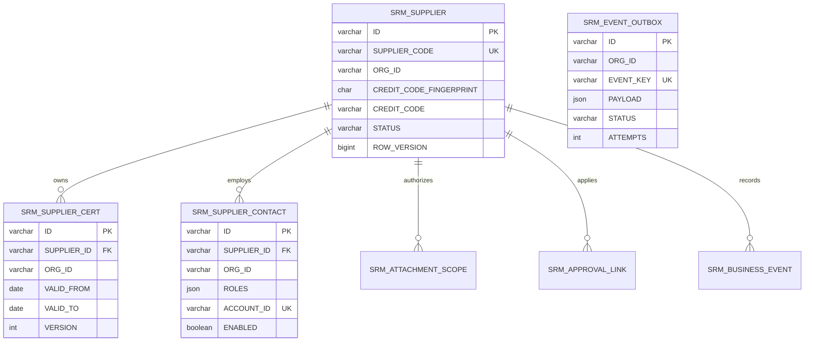

# 核心领域模型与数据库迁移

## 字段与约束

- ID与Snowy一致为varchar(20)，业务编码varchar(32)；金额后续用DECIMAL，不能用浮点。时间展示用Asia/Shanghai；写入时间明确业务时区/UTC转换策略。
- 供应商敏感值预留varchar(512)，存储`v1.keyId.iv.ciphertext.mac`封装。检索指纹为64位hex，唯一约束(ORG_ID,CREDIT_CODE_FINGERPRINT)。指纹列为空只用于现有数据安全迁移过渡；正式新建必须产生指纹。
- 已归档身份的唯一性保留；恢复原档案而不是重复新建。需要变更此策略时须业务评审并设计历史身份映射。
- 子表拥有ORG_ID，迁移时从父档案回填。当前DDL的普通外键只保证父记录存在，不能单独保证org一致；写服务需从已授权父对象复制org，并校验关联，后续可增加复合外键。
- 证书VALID_TO≥VALID_FROM；续期新版本保留旧版本。联系人ROLES采用枚举JSON数组，至少一名ADMIN为事务业务约束，不能靠页面判断。
- ROW_VERSION用于更新乐观锁；业务状态、归属组织、审批实例ID不能由通用更新DTO赋值。
- SRM_ATTACHMENT_SCOPE保存文件哈希/归属与下载权限；真实二进制走MinIO，所有下载必须先通过元数据授权。
- APPROVAL_LINK保存业务与流程的关联，不把Flowable所有内部表重复建模。BUSINESS_EVENT保存非敏感业务事件；本表本身不宣称签名不可篡改或达到五年留存。
- EVENT_OUTBOX payload只保存对象引用与允许公开的事件字段。生产需实现dispatcher、retry/backoff、幂等inbox、告警和归档。

## 已交付的迁移

- V1：对应上一步三张核心表，在空数据库建立基线。
- V2：指纹唯一索引、乐观锁、子表org回填，以及附件授权、审批关联、事件发件箱、业务事件表。
- Flyway10.20.1启用checksum校验、禁用clean、禁用自动baseline。
- `./scripts/test-foundation-db.sh`只新建唯一命名的srm_test_*数据库；实测空库迁移、重复无变更、旧三表副本baseline后升级、原有子表回填和指纹约束，然后删除测试库。

## 接管已有开发库的设计

当前`snowy`开发库仍由原有启动脚本管理，没有被悄悄改为Flyway库。正式切换需要单独执行：备份→核对三表DDL/数据孤儿→确认V1对应版本→显式baseline=1→执行V2→核验数量/唯一性→发布匹配实体及服务→停用旧幂等建表路径。SQL校验失败即停止，禁止自动baseline未知数据库。

生产使用受控迁移账户；应用账户不具备DDL权限，Flowable也使用版本化DDL升级。MySQL DDL会隐式提交，回退依赖备份恢复或向前修复，不能承诺一条事务回滚所有DDL。当前迁移测试证明模板副本升级，不等于已完成真实历史数据迁移。
